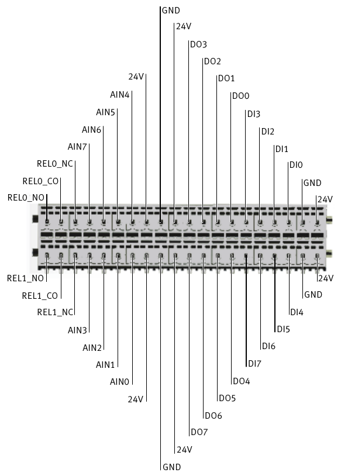

# IO connector of Robotino 1 and 2

The pin allocation from the Festo Robotino documentation:

The connector is two rows of 20 spring terminals. Robotino 3 and 4 have a different connector
(DI/DQ/AI terminals); this picture does not apply to them.

CO is the common contact of a relay. NO (normally open) is open while the relay is off and
connects to CO when it is switched on; NC (normally closed) is connected to CO while the relay is
off and opens when it is switched on.

## Terminal names and library indices

The terminals are numbered from 0, like the library: `set_digital_output(i, ...)` switches DO*i*,
`set_relay(i, ...)` switches REL*i*, `SensorState::digital_input[i]` is DI*i* and
`SensorState::analog_input[i]` is AIN*i* (0–10 V). The Robotino View help counts the same
terminals from 1 (DO1–DO8, AIN1–AIN8); its DO1 is DO0 here.

Measure the digital outputs against a GND terminal. The digital inputs can be driven from a 24V
terminal or from a digital output. The Robotino View help says a digital output that is on gives
+10 V, while Festo's data sheets give 24 V; check the first output with a multimeter.
